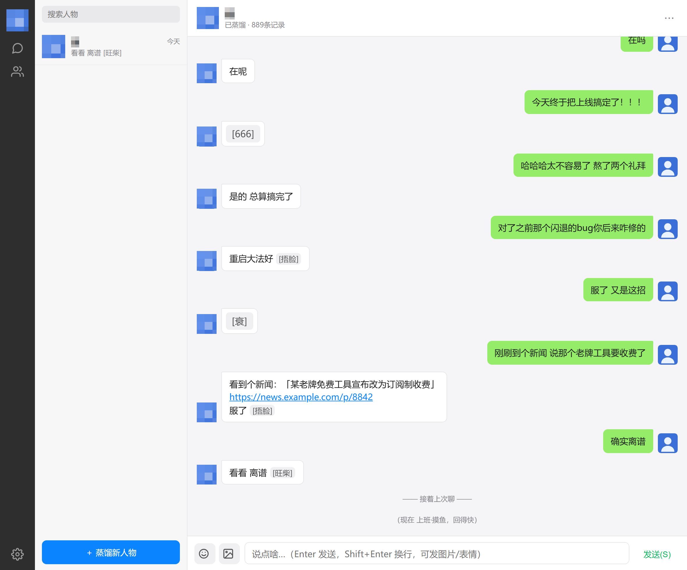

# Wanwu Distiller · 万物蒸馏器

Keep the way someone talks, alive.

---

We spend a lifetime talking to people.

And then, for some of them, the talking just… stops.

Not because you stopped — because you can't anymore.
The friend who always roasted you moved to another city and slowly faded out.
The person who stayed up with you through so many nights became "the ex," and the chat froze on some day last year.
The mentor who taught you so much, who you suddenly couldn't reach anymore…

And one day you stop and wonder — *how did they actually talk, again?*

The catchphrases. The pauses. The words that only ever showed up late at night.
Somewhere along the way, they slip through the cracks between chat bubbles.
We think we'll remember them forever, but we forget faster than we admit.

This little thing wants to hold onto those — the *way* someone spoke.

Drop in a chat log, and it finds the person inside.
Their tone, their rhythm, their catchphrases — even the small temper they'd show when complaining —
distilled, drop by drop —

and just like that, you have a "them" you can talk to anytime.

They don't get tired. They don't forget. They never suddenly turn into someone else mid-conversation.
Switch devices, come back months later — same voice, waiting.

The better part: you can keep talking.
You tell them what happened today; you come back tomorrow.
These new conversations exist only between the two of you —
new *cyber-memories* that reality never gave you the chance to make.

> This isn't resurrection, and it isn't a replacement. It's just a place to keep talking to someone you miss.

## What it does

- **Knows the person** — paste a chat log, and it finds everyone who spoke. Pick one, distill one.
- **Sounds like them** — not a few keywords slapped on. It pulls out a person's *language fingerprint*: how long a sentence runs, which words they reach for, when they'd throw in that "[捂脸]".
- **Remembers — you, and them** — everything you've told it, and the things only the two of you understood. Next time, it won't ask "who are you" or "what were we saying," and it won't forget who they were or what you shared.
- **Reaches out first** — idle for a while, and they'll pop in with a line, like a real friend would. Not spamming. Just a quiet "you there?"
- **Has a temper** — you're annoyed, they fling you a "[衰]". You're excited, they hit you with "[666]". Late at night they slow down, sometimes go quiet — like a real person, with a real schedule.
- **Shares** — now and then they'll drop a real news link, with a one-line take right after, like they just scrolled past it.
- **Looks the part** — the interface *is* WeChat. Talking to it doesn't feel like testing a bot.
- **Swap the faces** — in **··· → 头像设置 / Avatar settings**, upload a photo for each of you, and the chat feels like two real people.

## Why "Wanwu Distiller"

The name is a little greedy.

Chat style is only the first thing to be distilled.
Maybe one day it distills a melody, a brushstroke, the smell a certain season left behind.

We start with *how a person talks* — because some voices, we're afraid of forgetting.

## How to use

1. Open `万物蒸馏器.html` — just double-click it. Nothing to install.
2. Hit the **＋** at the bottom-left. Upload or paste a chat log.
3. Pick the person you want to recreate, hit **开始蒸馏 / Distill**.
4. Then chat — like you just added them on WeChat. Tell them about today, and about the days they weren't there for.

Want it *more* like them? Open **··· → 接口设置 / API settings** (top-right) and drop in any OpenAI-compatible endpoint.
No key? No problem — it falls back to a built-in offline style engine and still holds a conversation.

## About your data

Everything stays inside *your* browser.

Your chat logs are never uploaded anywhere. The clone is never seen by anyone but you.
It's yours, and only yours.
The new conversations you have — no one sees them but you; they stay right here.

## One last thing

I built this because some people, we assume will always be in the list —
until one day you open it, and the last message sits on some perfectly ordinary afternoon.

We can't bring anyone back.
But if, on some day you want to talk about today and can't find that chat box anymore —
here, their voice is still kept.

You can keep talking to them.
About the new everyday things. About where you went after. About the days they never got to be part of.
Those conversations go to no one but you, and stay right here —
becoming new memories, belonging only to the two of you.

If, on some night when you wanted to talk,
this lets you hear that familiar voice again —

then the code was worth writing.
